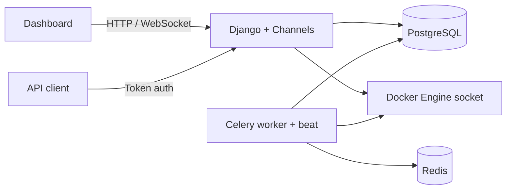

# MiniCloud

MiniCloud is a self-hosted Django platform for provisioning and monitoring local Docker containers. It gives each user a quota, keeps lifecycle state in the database, collects Docker metrics with Celery, and exposes both a browser dashboard and a token-authenticated API.

## Architecture



## MVT mapping

| Layer | MiniCloud implementation |
| --- | --- |
| Models | `accounts`, `servers`, and `monitoring` models store users, quotas, lifecycle state, snapshots, health checks, and incidents. |
| Views | Class-based server/template views render the dashboard and call the services layer. DRF viewsets expose the API. |
| Templates | `templates/` contains the Bootstrap dashboard, provisioning forms, incident history, Chart.js charts, and live log panel. |
| Services | `servers/services.py` owns provisioning and lifecycle actions. `servers/docker_service.py` is the only Docker SDK boundary. |
| Background work | Celery tasks collect metrics, prune old snapshots, restart unhealthy containers, and open or resolve incidents. |
| Realtime | Channels consumers stream metrics and Docker logs over authenticated WebSockets. |

## Local setup

Requirements: Python 3.12+, Docker Desktop or Docker Engine, and Redis. PostgreSQL is optional for local development because the default configuration falls back to SQLite, but PostgreSQL is used by Compose and CI.

```powershell
py -m venv .venv
.\.venv\Scripts\Activate.ps1
pip install -r requirements.txt
Copy-Item .env.example .env
```

Set a real `DJANGO_SECRET_KEY` in `.env`, then initialize the database and seed the built-in templates:

```powershell
.\.venv\Scripts\python.exe manage.py migrate
.\.venv\Scripts\python.exe manage.py seed_minicloud --password change-me
.\.venv\Scripts\python.exe manage.py runserver
```

Celery needs a broker. Start Redis locally with Docker, or use any other Redis reachable at `REDIS_URL`:

```powershell
docker run -d --name minicloud-redis --restart unless-stopped -p 127.0.0.1:6379:6379 redis:7-alpine
```

Start a Celery worker and beat process in separate terminals. Windows has no `fork`, so the worker needs `--pool=solo` (or `--pool=threads`):

```powershell
.\.venv\Scripts\celery.exe -A minicloud worker --pool=solo --loglevel=info
.\.venv\Scripts\celery.exe -A minicloud beat --loglevel=info
```

Without worker and beat, nothing collects metrics, checks container health, restarts dead containers, or opens and resolves incidents: the dashboard only shows whatever the last request left in the database.

Uncomment `CHANNEL_REDIS_URL` in `.env` if the worker should push notifications into open dashboard websockets. Django keeps `channels.layers.InMemoryChannelLayer` while it is commented, and an in-memory layer cannot cross process boundaries, so worker-created alerts are stored but never delivered live. Restart `runserver` after changing it.

Open `http://127.0.0.1:8000/`. Real provisioning requires Docker Desktop to be running.

## Alert thresholds

Both resource alerts compare against the container's own quota, not the host: `MINICLOUD_HIGH_CPU_PERCENT` is the share of `template.cpu_limit` and `MINICLOUD_HIGH_MEMORY_PERCENT` is the share of the memory actually given to the container, which is `max(template.memory_mb, MINICLOUD_XAMPP_MIN_MEMORY_MB)` for PHP images. A breach must hold for a full 60-second window of snapshots before an incident opens, and `MINICLOUD_HEALTH_DOWN_FAILURES` consecutive failed health checks (default 3, so 30 seconds at the 10-second interval) are required before a Down incident opens or a container is auto-restarted. `HealthCheck.consecutive_failures` resets on any successful check.

## SSH access

Tick **Enable SSH access** when provisioning, or post `ssh_enabled` with `ssh_public_key` to `/api/servers/`. MiniCloud allocates a second host port from the same `MINICLOUD_PORT_RANGE_*` pool, forwards it to `sshd` on port 22 inside the container, installs OpenSSH with whichever package manager the image provides (`apk`, `apt-get`, `dnf`, `yum`), writes the key to `/root/.ssh/authorized_keys` and starts the daemon with `PermitRootLogin=prohibit-password`, `PasswordAuthentication=no`, `PermitEmptyPasswords=no`, `KbdInteractiveAuthentication=no`, `MaxAuthTries=3`, `LoginGraceTime=30`, `MaxStartups=10:30:60` and a 300-second client alive interval. Only the public key you supply can sign in, and no private key is generated or stored anywhere.

**Allowed from.** List the source addresses that may connect (`203.0.113.7, 198.51.100.0/24`, comma or newline separated) or leave it blank to accept any source. Every entry is normalised to CIDR and written onto the key as `from="…"`, which sshd checks before it offers a signature, so other addresses are refused without reaching the key at all. Hostnames are rejected on purpose: sshd would resolve them through a reverse DNS lookup that the connecting host controls. The value can be changed later — `PATCH /api/servers/<id>/ {"ssh_allowed_from": "203.0.113.7"}` or the **Allowed from** box on the server page — and is pushed into the running container immediately. Keep one address you control reachable while you test, so a typo cannot lock you out.

`sshd` is not the container entrypoint, so MiniCloud re-applies the key and restarts the daemon on every start, restart and health-check auto-restart. `PATCH /api/servers/<id>/` also accepts a replacement `ssh_public_key`; turning SSH on or off afterwards would need new port bindings, so it stays a provisioning-time choice.

### Which address clients connect to

The command shown on the server page is `ssh -p <ssh port> root@<MINICLOUD_SSH_HOST>`. `MINICLOUD_SSH_HOST` falls back to `MINICLOUD_PUBLIC_HOST`; set it on its own line when the published apps should stay on `localhost` while SSH uses another name. Docker Desktop publishes the container port on the Windows host, so that address is only as reachable as the path behind it:

- **This machine** — the default `localhost` works as it is.
- **Another device on the LAN** — set `MINICLOUD_SSH_HOST` to this machine's LAN address.
- **Anywhere on the internet** — forward a router port to this machine, as described below. This is the only option that puts a shell on the public internet, so read the hardening list first.
- **Anywhere, without exposing anything** — put the host and the client on an overlay network such as Tailscale and set `MINICLOUD_SSH_HOST` to the Tailnet address. Prefer this unless you specifically need SSH reachable from networks you do not control.

**Check reachability** on the server page calls `POST /api/servers/<id>/ssh/check/`, which opens a TCP connection to the advertised host and port and reads the banner. It answers `open` with the sshd version, `not_ssh` when something else listened (a forward at the wrong port), or `refused` / `timeout` / `unresolved`. Note that most routers will not loop their own public address back into the LAN, so a failed check on a forwarded host does not prove the path is broken — confirm from outside the network.

### Publishing SSH through a router

1. **Fix the target.** Note this machine's LAN address (`ipconfig`) and the SSH port on the server page, then reserve that LAN address for the machine in the router's DHCP settings so the forward cannot drift onto another device.
2. **Open the forward.** In the router's *Port Forwarding / Virtual Server / NAT* page, map a TCP external port to `<LAN address>:<SSH port>`. Pick an external port that is not 22 — scripted scanners find 22 within minutes of it appearing.
3. **Name the host.** With a static IPv4 from the ISP, use it. Otherwise enable the router's DDNS client (No-IP, Duck DNS, or a domain on Cloudflare) and point `MINICLOUD_SSH_HOST` at the resulting name. If the client IP is dynamic too, put that address in **Allowed from** and update it when it changes.
4. **Let it through the host.** Docker Desktop forwards through its own proxy, so a Windows rule is usually unnecessary; add one only if the LAN test fails:

   ```powershell
   New-NetFirewallRule -DisplayName "MiniCloud SSH 10101" -Direction Inbound -Protocol TCP -LocalPort 10101 -Action Allow
   ```

5. **Verify from outside.** `ssh -p <external port> root@<host>` from a device on another network, such as a phone on mobile data. The command MiniCloud copies out of the server page uses the *published* port, so when the router listens on a different external port, replace it. Then set **Allowed from** down to the addresses you actually connect from.
6. **Undo it** by deleting the forward, and `Remove-NetFirewallRule -DisplayName "MiniCloud SSH 10101"` if the rule was added. Nothing else in MiniCloud has to change; the container keeps serving locally.

If the router's WAN address itself looks private (`100.64.0.0/10`, `10.x`, `100.x`), the ISP is using CGNAT and no port forward will ever work — use the overlay-network option instead.

## Docker Compose

Compose starts Django, PostgreSQL, Redis, Celery worker, and Celery beat. The web and worker services mount `/var/run/docker.sock`, allowing MiniCloud to manage the host Docker daemon.

```powershell
Copy-Item .env.example .env
# Set POSTGRES_DB, POSTGRES_USER, POSTGRES_PASSWORD if desired.
docker compose up --build
```

The dashboard is available at `http://localhost:8000/`.

## API

Obtain a token:

```text
POST /api/token/
{"username": "demo", "password": "..."}
```

Send it as `Authorization: Token <token>`. Available endpoints:

- `GET, POST /api/servers/`
- `GET, PATCH, DELETE /api/servers/<id>/` — `PATCH` accepts `name`, `custom_image`, `env_vars`, `ssh_public_key` and `ssh_allowed_from`
- `POST /api/servers/<id>/start/`
- `POST /api/servers/<id>/stop/`
- `POST /api/servers/<id>/restart/`
- `POST /api/servers/<id>/ssh/check/` — TCP probe of the advertised SSH host and port
- `GET /api/servers/<id>/metrics/`

## Tests and CI

```powershell
.\.venv\Scripts\python.exe -m pytest -q
.\.venv\Scripts\python.exe manage.py check
.\.venv\Scripts\python.exe manage.py makemigrations --check --dry-run
```

GitHub Actions runs Ruff, Django checks, migration drift checks, and pytest against PostgreSQL and Redis.

