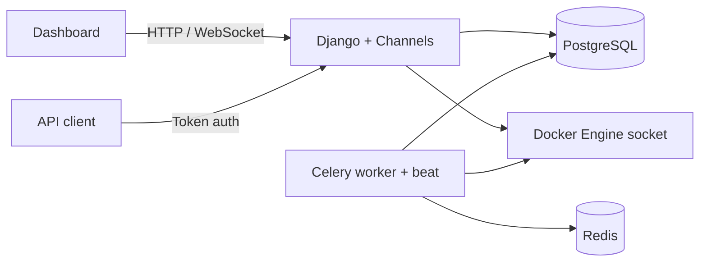

# MiniCloud

MiniCloud is a self-hosted Django platform for provisioning and monitoring local Docker containers. It gives each user a quota, keeps lifecycle state in the database, collects Docker metrics with Celery, and exposes both a browser dashboard and a token-authenticated API.

## Architecture



## MVT mapping

| Layer | MiniCloud implementation |
| --- | --- |
| Models | `accounts`, `servers`, and `monitoring` models store users, quotas, lifecycle state, snapshots, health checks, and incidents. |
| Views | Class-based server/template views render the dashboard and call the services layer. DRF viewsets expose the API. |
| Templates | `templates/` contains the Bootstrap dashboard, provisioning forms, incident history, Chart.js charts, and live log panel. |
| Services | `servers/services.py` owns provisioning and lifecycle actions. `servers/docker_service.py` is the only Docker SDK boundary. |
| Background work | Celery tasks collect metrics, prune old snapshots, restart unhealthy containers, and open or resolve incidents. |
| Realtime | Channels consumers stream metrics and Docker logs over authenticated WebSockets. |

## Local setup

Requirements: Python 3.12+, Docker Desktop or Docker Engine, and Redis. PostgreSQL is optional for local development because the default configuration falls back to SQLite, but PostgreSQL is used by Compose and CI.

```powershell
py -m venv .venv
.\.venv\Scripts\Activate.ps1
pip install -r requirements.txt
Copy-Item .env.example .env
```

Set a real `DJANGO_SECRET_KEY` in `.env`, then initialize the database and seed the built-in templates:

```powershell
.\.venv\Scripts\python.exe manage.py migrate
.\.venv\Scripts\python.exe manage.py seed_minicloud --password change-me
.\.venv\Scripts\python.exe manage.py runserver
```

Celery needs a broker. Start Redis locally with Docker, or use any other Redis reachable at `REDIS_URL`:

```powershell
docker run -d --name minicloud-redis --restart unless-stopped -p 127.0.0.1:6379:6379 redis:7-alpine
```

Start a Celery worker and beat process in separate terminals. Windows has no `fork`, so the worker needs `--pool=solo` (or `--pool=threads`):

```powershell
.\.venv\Scripts\celery.exe -A minicloud worker --pool=solo --loglevel=info
.\.venv\Scripts\celery.exe -A minicloud beat --loglevel=info
```

Without worker and beat, nothing collects metrics, checks container health, restarts dead containers, or opens and resolves incidents: the dashboard only shows whatever the last request left in the database.

Uncomment `CHANNEL_REDIS_URL` in `.env` if the worker should push notifications into open dashboard websockets. Django keeps `channels.layers.InMemoryChannelLayer` while it is commented, and an in-memory layer cannot cross process boundaries, so worker-created alerts are stored but never delivered live. Restart `runserver` after changing it.

Open `http://127.0.0.1:8000/`. Real provisioning requires Docker Desktop to be running.

## Alert thresholds

Both resource alerts compare against the container's own quota, not the host: `MINICLOUD_HIGH_CPU_PERCENT` is the share of `template.cpu_limit` and `MINICLOUD_HIGH_MEMORY_PERCENT` is the share of the memory actually given to the container, which is `max(template.memory_mb, MINICLOUD_XAMPP_MIN_MEMORY_MB)` for PHP images. A breach must hold for a full 60-second window of snapshots before an incident opens, and `MINICLOUD_HEALTH_DOWN_FAILURES` consecutive failed health checks (default 3, so 30 seconds at the 10-second interval) are required before a Down incident opens or a container is auto-restarted. `HealthCheck.consecutive_failures` resets on any successful check.

## Docker Compose

Compose starts Django, PostgreSQL, Redis, Celery worker, and Celery beat. The web and worker services mount `/var/run/docker.sock`, allowing MiniCloud to manage the host Docker daemon.

```powershell
Copy-Item .env.example .env
# Set POSTGRES_DB, POSTGRES_USER, POSTGRES_PASSWORD if desired.
docker compose up --build
```

The dashboard is available at `http://localhost:8000/`.

## API

Obtain a token:

```text
POST /api/token/
{"username": "demo", "password": "..."}
```

Send it as `Authorization: Token <token>`. Available endpoints:

- `GET, POST /api/servers/`
- `GET, PATCH, DELETE /api/servers/<id>/`
- `POST /api/servers/<id>/start/`
- `POST /api/servers/<id>/stop/`
- `POST /api/servers/<id>/restart/`
- `GET /api/servers/<id>/metrics/`

## Tests and CI

```powershell
.\.venv\Scripts\python.exe -m pytest -q
.\.venv\Scripts\python.exe manage.py check
.\.venv\Scripts\python.exe manage.py makemigrations --check --dry-run
```

GitHub Actions runs Ruff, Django checks, migration drift checks, and pytest against PostgreSQL and Redis.

